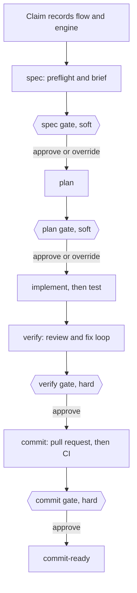

# Playbook real engine

Chocolate Factory V1 rehearses a run with a simulator. This design adds a second engine that does the work: feature and bug flows adapted from [ollymarkey/skills](https://github.com/ollymarkey/skills). `RunService` remains the only composer. The cockpit remains the only place a person approves, reworks, or overrides a gate. A finished run is commit-ready when a non-draft pull request is open and CI is green. Nothing is merged.

## Decisions

- The engine walks by itself and stops only when a gate needs a person.
- Commit-ready means the pull request is open, it is not a draft, and CI is green. An unresolved pass-1 must-fix opens a draft and fails the commit gate.
- Chocolate owns the walk. Skill behavior is vendored as phase playbooks. The factory does not launch `/factory-feature` or `/factory-bug` as one session.
- The simulator stays the rehearsal engine and the default claim.
- GitHub issues and an existing contract are the only intake sources. Jira, Linear, and Egg are out of this slice.
- Model names are not copied from that repo. Two worker roles are configured locally, and an implement-route failure falls back once to the default role.
- Run artifacts live under `.chocolate/runtime/`, which is already gitignored. The factory does not create a `.factory/` directory.
- Auto-merge, webhooks, multi-repo orchestration, and a hosted cockpit stay out.

## Architecture

`PlaybookRunEngine` implements the existing `RunEngine` interface. The simulator still implements it too. A claim records `flow: feature | bug` and `engine: simulator | playbook` on the run.

A playbook claim, a rework, and an approval or override of spec, plan, or verify enqueue a background walk. The HTTP handler returns the current run and does not wait for the walk. The walk calls `advance` until the run is `awaiting-decision`, `failed`, or `commit-ready`. One walk per run; a second trigger for that run does nothing while the first is in memory. Approving commit sets `commit-ready` and does not continue. The walk never merges.



Phases and gates:

| Phase | Feature | Bug | Gate |
| --- | --- | --- | --- |
| spec | Confirm a clean tree, create `feat/<slug>` from the default branch, write `brief.md`. | Same, on `fix/<slug>`. | Soft. The operator approves the brief. Open questions require answers on approve. |
| plan | Write `plan.md` with file-disjoint work units. Explore as **Plan, feature** specifies. | Write a failing `repro.md`, then a one-unit plan whose check is that test. | Soft. Production files stay unchanged until this gate is approved. A bug that cannot be reproduced fails the run here. |
| implement | Parallel waves. The engine checks allowed files and re-runs each unit command. Local commits stay on the run branch. | One unit. The repro test file stays unchanged. | None. |
| test | The engine re-runs the plan's full test, lint, and typecheck. | Same, and the repro command passes with an empty diff on the test file. | None. |
| verify | At most three review passes and two fix rounds. Only pass-1 must-fix items are fixed. | Same. | Hard. The loop finished under those rules. Unresolved pass-1 items remain in the evidence, and the gate can still pass. |
| commit | Push the run branch. Open or update the pull request. Babysit CI only when every pass-1 item is resolved. | Same. | Hard. Passes only when the pull request evidence says `open` and `ci-green` is present. |

`<slug>` is `gh-<issue-number>` when the run is claimed from a GitHub issue. Otherwise it is the contract id. Rework on spec starts attempt N+1 at spec. Rework on plan, verify, or commit starts attempt N+1 at plan. Earlier attempts stay in the log and on disk.

The cockpit defaults a claim to feature and simulator, so the current button keeps today's behavior. A playbook claim shows the flow and engine choices. Simulator runs keep **Advance**. A playbook run shows **Advance** only while its state is `running`, as the way to restart a walk after the process stopped. The run detail polls `GET /api/runs/:id` every two seconds while the state is `running`.

`later-real-engine` keeps its id. Its milestone becomes a new roadmap milestone `real-engine`, and `later-phases` no longer lists it. The deferred placeholder criterion is replaced by these three:

- `ac-playbook-walk`, mapped to verify and commit. Evidence: `tests/engine/playbook/feature.test.ts`. A feature claim reaches commit-ready.
- `ac-playbook-bug`, mapped to verify. Evidence: `tests/engine/playbook/bug.test.ts`. A bug claim reproduces before the plan gate, and an edit to the repro test fails the run.
- `ac-playbook-commit`, mapped to commit. Evidence: `tests/gates/gateEvaluator.test.ts`. A draft or red CI fails the commit gate, and a simulator commit with verify-phase `verification-check` still passes.

V1 contracts stay on milestone `v1`.

## Components

| Unit | Responsibility | Depends on |
| --- | --- | --- |
| `RunWalker` | Enqueues and runs one walk per run. | `RunService` |
| `PlaybookRunEngine` | `runPhase` selects the feature or bug module and returns events plus evidence. | phase modules |
| Phase modules | `spec`, `plan`, `implement`, `test`, `verify`, `commit`. Each reads and writes its own artifacts and does not call another phase. | ports and `RunFolder` |
| `WorkerPort` | Runs one task. Returns `done`, `partial`, or `blocked`, the files changed, and the route used. | configured process |
| `CommandRunner` | Re-runs unit commands, the test plan, and a CI step locally. | the repo |
| `GitPort` | Status, default branch, fetch, branch, commit, diff, and push. Push is callable only from the commit phase. | the target repo |
| `ForgePort` | Read a GitHub issue. Create or update a pull request. List checks. Rerun failed jobs. | `gh` |
| `RunFolder` | Attempt directory and append-only `status.md`. | `.chocolate/runtime` |

Playbook text ships in the factory package:

- `src/engine/playbooks/spec.md`
- `src/engine/playbooks/plan-feature.md`
- `src/engine/playbooks/plan-bug.md`
- `src/engine/playbooks/implement.md`
- `src/engine/playbooks/verify.md`
- `src/engine/playbooks/commit.md`

The test phase has no playbook. It runs commands. Ticket text is untrusted requirements. Workers receive file paths, the repo root, the allowed files, the verification command, and the rules below. They do not receive pasted ticket threads.

`WorkerPort` is a process adapter. `.chocolate/config.yaml` gains:

```yaml
workers:
  default:
    command: []
  implement:
    command: []
```

Each `command` is an argv list. The adapter sets `CHOCOLATE_REPO`, `CHOCOLATE_RUN_DIR`, and `CHOCOLATE_ROLE`, sets the cwd to the repo root, and appends the prompt-file path as the last argument. It does not invoke a shell. The worker writes `<run-dir>/worker-report.md` containing a line `STATUS: done|partial|blocked`. A missing report, or a process that cannot be spawned, is `blocked`. When the implement command cannot be spawned, that unit runs once with the default command, and `status.md` gains `fallback: <unit> implement→default (<reason>)`. Tests use an in-memory port.

A missing `workers` block is stored as two empty command lists. A playbook claim is rejected with no run created when either command list is empty.

The runs table gains `flow` and `engine`. New databases create them. An existing runtime database adds them with defaults `feature` and `simulator`. `RunRecord` carries both.

Spec checks that the tree is clean and that the branch name is absent, then creates the branch. Later phases check that the tree is clean and that HEAD is that branch, and fail the run otherwise.

## Phase behavior

**Spec.** Resolve the default branch with `ForgePort` (`gh repo view`), then `origin/HEAD`. Write `brief.md` from the issue title, body, and comments, or from the contract title and intent when the claim has no issue. The brief lists testable requirements and, when the flow is bug, expected behavior, actual behavior, and steps. Gaps go under Open questions. The phase invents no requirements. `RunService` reloads the contract from disk after `runPhase` returns and before `evaluateGate`. The phase updates this run's `contractRevision` to the new file hash and does not call `invalidateForContract`.

Criterion gates after spec:

- An empty acceptance list becomes one criterion per brief requirement, each mapped to `spec`, `verify`, and `commit`.
- An existing list is left in place. If no criterion maps to `spec`, the phase adds `spec` to the first criterion. If no criterion maps to `commit`, the phase adds `commit` and `verify` to the first criterion.

**Plan, feature.** The phase always starts two default-role explore workers: where the behavior lives, and how it is tested. When those two reports name files under more than one top-level directory, it starts two more: patterns to reuse, and integrations or public APIs affected. Each report is at most 40 lines. The combined findings become `explore.md`. One default-role planner writes `plan.md` with acceptance criteria, file-disjoint work units, a verification command per unit, and a test plan. Units that would share a file are merged, or ordered with `Depends on`. The engine checks that named files exist or are marked new, that dependencies are acyclic, and that every acceptance criterion has a test. One correction pass is allowed. A plan that still fails those checks fails the run. A plan statement that is not already a criterion is added, mapped to `plan`, `verify`, and `commit`. If no criterion maps to `plan` after that, the phase adds `plan` to the first criterion. The revision rule is the same as spec.

**Plan, bug.** The lowest faithful test is a unit or integration test in the repo's framework. Playwright is used only when the repo already depends on `@playwright/test`. The test must fail for the reported symptom on two consecutive runs. `repro.md` records `reproduced` or `not-reproduced`. `not-reproduced` fails the run and does not offer the plan gate. A reproduced bug writes a one-unit plan. The unit may touch production files and may not touch the repro test. Its check is the repro command.

**Implement.** Group units into waves by `Depends on`. When two units in a wave share a file, the one with the later id moves to the next wave. Each unit is one implement-role worker, and every unit in the wave is dispatched together. The scope check uses `git status --porcelain`. The engine reverts tracked paths outside the allowed files, deletes new untracked files outside that list, and re-runs the unit command. One retry follows a `partial` or `blocked` status or a failed command. A second failure marks that unit blocked. The rest of the current wave still finishes. Later waves that depend on a blocked unit are skipped. The phase then fails the run. Local commits are one per completed wave, or one commit when there is a single wave, with a `feat:` or `fix:` message. Implement does not push. A bug unit whose diff touches the repro test is reverted, and the run fails.

**Test.** The engine runs the plan's full commands. A failure dispatches one implement-role worker whose allowed files are the paths changed since the base SHA, at most twice. The run fails when checks are still red. In bug flow the repro command passes and `git diff <base> -- <repro test>` is empty.

**Verify.** Reviewers and the verifier use the default role. Fix workers use the implement role. The diff is saved to `review-<N>.diff`. Fewer than 300 changed lines uses one reviewer. 300 or more uses three reviewers: correctness, tests and intent, and security, data, and performance. A finding needs a file, a line, a failure scenario, and a suggested fix. A verifier worker tries to disprove every must-fix candidate. Confirmed findings are classified:

- **Must fix.** Wrong behavior, crash, data loss, security hole, a broken build or test, a regression, an unmet acceptance criterion, new behavior with no test, or a weakened repro test.
- **Nice to fix.** Real, lower impact.
- **Could fix.** Polish.

Pass 1 ids are `M1`, `M2`, and so on. The baseline is those ids. Later passes re-check the baseline as `resolved`, `partial`, or `open`. New must-fix ids are `P<N>-M1` and are recorded as deferred. They are not sent to fix. Nice and Could are not sent to fix. Fix runs only while the pass number is less than 3 and a baseline item is still open, so there are at most two fix rounds. The phase writes `verification-check` evidence from the verify phase covering every criterion mapped to verify, including when a baseline item is still open. The summary contains the baseline resolved count, the baseline open count, and the deferred count.

**Commit.** Push with `git push -u origin HEAD`. Never force-push. Never push a branch other than the run branch. If a pull request already exists, update its body. Otherwise create one. The body comes from `pr.md`, written by one default-role worker from the attempt's artifacts, and it includes unresolved baseline items, deferred must-fix items, and the nice and could backlog. The pull request is a draft when any baseline item is `open` or `partial`. Babysit runs only for an open pull request. Evidence `pull-request` has summary `open` or `draft`. Evidence `ci-green` is written only when every check is green, and its summary is the head SHA.

## Data flow

Artifacts for attempt N live in `.chocolate/runtime/runs/<runId>/attempt-<N>/`. `status.md` in that directory records flow, source, branch, base SHA, phase, pull request URL, decisions, the baseline table, deferred must-fix items, and fallbacks. Each phase appends the lines it owns.

| Phase | Artifact | Evidence kind | Gate |
| --- | --- | --- | --- |
| spec | `brief.md` | `brief` | Soft spec. Covers spec criteria. |
| plan | `explore.md` or `repro.md`, then `plan.md` | `plan-summary` | Soft plan. For a bug, written only when `repro.md` says `reproduced`. |
| implement | `implement.md`, local commits | `implement-summary` | None. Verify and commit ignore it. |
| test | Command output appended to `implement.md` | `test-summary` | None. |
| verify | `review-<N>.md`, `fix-<N>.md` | `verification-check` from verify | Hard verify. |
| commit | `pr.md`, `babysit.md` | `pull-request`, and `ci-green` when CI is green | Hard commit. |

For a playbook attempt the commit gate passes only when all of these are true: some `pull-request` evidence on the attempt has summary `open`, some `ci-green` evidence has producer phase `commit`, every criterion mapped to commit has verify-phase `verification-check` evidence, and every dependency is commit-ready. A `draft` summary fails the gate. Simulator attempts write no `pull-request` evidence. Their commit gate still passes on verify-phase `verification-check`, and still fails when a dependency is not commit-ready.

Spec approval accepts a string `answers`. When `brief.md` has an Open questions section with at least one bullet, approve without answers is rejected and the run stays `awaiting-decision`. Supplied answers are written into the brief and under Decisions before the walk resumes. Override of spec or plan still requires a recorded reason and may proceed without answers. Verify and commit reject override.

`GET /api/runs/:id` adds the attempt's file names and the pull request URL from `status.md`.

## Error handling

A failed run stays on its branch. An open or draft pull request is left as it is. The reason is an event and a line in `status.md`.

Spec fails the run, before any worker, when the directory is not a git checkout, the working tree is dirty, the branch name already exists, or the default branch cannot be resolved. Nothing is stashed, discarded, reset, or resumed. The same dirty-tree failure applies at the start of every later phase.

A unit or fix item that returns `partial` or `blocked`, or whose command fails when the engine re-runs it, is dispatched once more. Stray files are reverted before that decision. A second failure marks the item blocked. The current wave finishes, and the run then fails.

CI wait duration and the extra no-checks interval are constructor arguments. The defaults are 60 minutes and 30 seconds. Tests set both to zero. The commit phase watches checks until the wait duration elapses. If the first result lists no checks, the phase waits one extra interval and reads them once more. Still no checks fails the commit gate. Checks still pending when the wait duration elapses fail it. One infrastructure failure (runner error, network timeout, or a cancelled job unrelated to the change) is rerun and does not count as a fix. A code or config failure gets at most three implement-role fix attempts. `babysit.md` records each attempt. A remote head that moved before push fails the run and is left untouched.

Rework creates `attempt-<N+1>/` and leaves the previous directory. The new attempt is enqueued. If the process stops while the state is `running`, **Advance** runs the current phase again and overwrites that attempt's artifact for that phase only.

## Testing

Vitest drives every path. Tests do not start a live model, push, or call `gh`. The simulator suite, including the fixture end-to-end, still uses the simulator and still reaches commit-ready through **Advance**.

Fakes stand in for `WorkerPort`, `CommandRunner`, `GitPort`, and `ForgePort`.

| Scenario | Proves |
| --- | --- |
| Feature happy path | A playbook claim walks to the spec gate. Approvals resume the walk. After spec, plan, verify, and commit approvals the state is commit-ready. The attempt has `brief`, `plan-summary`, `verification-check`, `pull-request` summary `open`, and `ci-green`. |
| Bug happy path | Plan evidence is written only after `repro.md` says `reproduced`. The run then reaches commit-ready on an open pull request with green CI. |
| Repro test edited | The implement worker's edit to the repro test is reverted and the run fails. |
| Dirty tree, existing branch | Spec fails before a worker runs. |
| Not reproduced | The plan phase fails the run and does not offer the plan gate. |
| Second unit failure | One retry, then the run fails. |
| Open pass-1 must-fix | Verify can pass. Commit records `draft` and the commit gate fails. |
| CI flake | One rerun, then green checks, passes the commit gate. |
| CI red | Three code-fix failures fail the commit gate. |
| CI absent or pending | No checks after the extra read, or checks still pending at the timeout, fail the commit gate. |
| Rework | Attempt 2 is a new directory. Attempt 1 remains. |
| Hard override | Verify and commit reject override. |
| Empty worker command | A playbook claim is rejected and no run is stored. |
| Reviewer split | A diff of 299 lines dispatches one reviewer. A diff of 300 lines dispatches three. |
| Simulator claim | Does not auto-walk. A simulator commit with verify-phase `verification-check` still passes. |

Tests live in `tests/engine/playbook/`, with the new commit clause in `tests/gates/gateEvaluator.test.ts` and the walker cases in `tests/runs/runService.test.ts`.

## Out of scope

- Copying `gpt-6.1-sol`, T3 Code, or Codex CLI routing into config.
- Launching the upstream entry skills as a single agent session.
- Jira, Linear, and Egg intake.
- Merging a pull request, including the existing `later-auto-merge` contract.
- Webhooks, multi-repo orchestration, hosted cockpit, and harness automation that approves gates without a person.
- Rewriting V1 simulator behavior or its tests.
