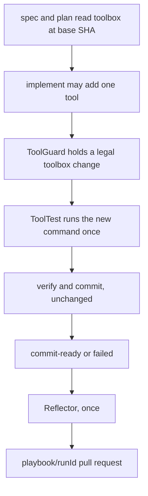

# Recursive harness for Chocolate Factory

A playbook run may leave two artifacts. A tested tool ships in the product pull request and becomes visible only after a person merges it to the default branch. A playbook proposal ships as a separate pull request on the factory repo and becomes the running playbooks only after a person merges it and the factory process starts again. The factory stays the grader. Nothing is hot-swapped into a running process, and nothing is merged by the factory.

This adapts the mechanism from [Recursive Harness: Self-Improving Agents Without Training](https://www.youtube.com/watch?v=XaJi7a0UChs): a tool is kept only when its check passes, a later task can reuse it, and the loop that decides "done" stays outside the agent's write set. The video's win was repeated expensive work saved as a library. The video's failures were a growing checklist, re-checking a page that had already passed, and copying hidden check names. Those failures are closed here by caps, a single test run, and a frozen grader.

## Decisions

- The walk stays spec, plan, implement, test, verify, commit. The simulator stays the default and does not reflect.
- A playbook run may add one tool under `chocolate-tools/` on the target repo during implement. The test phase runs that tool's test once. A failure restores `chocolate-tools/` to the base SHA, and the feature run continues.
- Spec and plan read `chocolate-tools/` from the base SHA recorded at spec, which is the default-branch commit the run branched from. An open product pull request is invisible to later runs until a person merges it.
- After a playbook run is commit-ready or failed, one reflection may open one pull request on the factory repo. The diff may touch only the six phase playbooks. The factory does not start a run for it, does not merge it, and does not load it.
- Playbooks are copied into memory when the process starts. A merge on disk does not change a running process.
- The gate evaluator, the commit-ready rule, the fixture checks, and the phase TypeScript stay out of both diffs.
- The first tool on an empty toolbox may be an addition. After that, a run that adds a tool also removes one tool that exists on the base, in the same wave, or the addition is reverted.
- The playbook diff cap is 40 changed lines. A diff whose additions outnumber its deletions is discarded.
- Reflection runs once per finished playbook attempt. It does not run again for the pull request it opened.
- This design adds no key broker and no retry loop around a check that already passed.

## Architecture



`chocolate-tools/` lives at the root of the target repo. It is committed. It is not under `.chocolate/` and not under `.chocolate/runtime/`.

Each tool is a directory `chocolate-tools/<name>/`. `chocolate-tools/manifest.md` has one section per tool:

```
## <name>
use: one sentence
test: <one command>
```

`chocolate-tools/NOTES.md` is the short note for a later run. It may be rewritten only in a wave that also makes a legal tool change, and it is reverted when it is longer than 80 lines.

The factory package root is the directory that contains `src/engine/playbooks/`, resolved from the running module. The playbook pull request is cut from that repo's default branch as `playbook/<runId>`, in a worktree under `.chocolate/runtime/worktrees/`. The product checkout stays on its run branch. When the target repo is the factory itself, the playbook pull request is still that second branch. A product run that edits `src/engine/playbooks/` gets that edit reverted, because those paths are never held.

## Components

| Unit | What it does | Depends on |
| --- | --- | --- |
| `Toolbox` | Pure rules: manifest parse, 80-line cap, add/remove decision, hold paths. Reads files at a revision through `ToolboxGit`. | `ToolboxGit` |
| `ToolGuard` | After each implement wave, holds a legal `chocolate-tools/` change so the existing scope revert leaves it in place. Reverts every other toolbox edit and every playbook edit. | `Toolbox`, `GitPort` |
| `ToolTest` | Runs the new tool's `test` command once through the existing command runner. On failure, or a dirty tree after the command, restores `chocolate-tools/` to the base SHA and commits that restore. | `CommandRunner`, `ToolboxGit` |
| `PlaybookSnapshot` | Copies the six phase playbooks into memory at process start. Every phase reads the copy. | factory package at boot |
| `Reflector` | Runs once after commit-ready or failed for a playbook run. Reads the attempt folder. Asks the default worker for a playbook diff. Publishes it only when the diff passes the rules. | `WorkerPort`, `PlaybookPublisher` |
| `PlaybookPublisher` | Adds `playbook/<runId>` in a worktree, commits, pushes, opens one pull request, then deletes the worktree. | git, `gh` |

`ToolboxGit` is a narrow port implemented by `GitCli`: `show(repo, rev, path)` and `restoreTree(repo, rev, path)`. It is not added to `GitPort`, so existing fakes stay valid. The server passes the same `GitCli` instance as both.

The reflector's instructions live in code. The diff may touch only `spec.md`, `plan-feature.md`, `plan-bug.md`, `implement.md`, `verify.md`, and `commit.md`. A diff over 40 changed lines, a diff that adds more lines than it deletes, a diff that touches anything else, and an empty diff are discarded. Changed lines are the multiset difference of the before and after line lists. If the factory package is not a git checkout, the reflector writes `reflect: skipped` and does not call the worker. The tool path is left alone. The default branch for a playbook pull request is `origin/HEAD` when that ref exists, otherwise `main`.

`RunService` gains an optional `onTerminal` callback. It runs only when a playbook run has just become commit-ready or failed. A throw from the callback does not change the run state. The simulator never triggers it.

## Data flow

Spec records `- base: <branch>@<sha>` as it does today. Spec and plan append the toolbox text from that SHA: `manifest.md` plus `NOTES.md`, together capped at 80 lines. A missing file at that SHA counts as empty. An empty toolbox appends nothing.

Implement appends the add/remove rule to the worker prompt. It also appends `Drop: <name>` when the newest `reflect.md` under `.chocolate/runtime/runs/` names a tool that is still on the base SHA. `ToolGuard` compares the manifest at the base SHA with the manifest in the working tree after the wave. A legal change is held. Anything else under `chocolate-tools/`, and any path under `src/engine/playbooks/`, is left for the existing scope revert.

`ToolTest` runs during the test phase, before the plan's commands, and it runs the new tool's `test` command once. A non-ok result, or a dirty tree after the command, restores `chocolate-tools/` to the base SHA, commits `chore: revert toolbox` when the tree is dirty, and appends `tool: reverted <name>` to `status.md`. The feature diff stays. Verify and commit proceed. The product pull request contains only the toolbox that survived.

When the state is commit-ready or failed, the reflector reads `brief.md`, `plan.md`, `implement.md`, `status.md`, `review-*.md`, and `pr.md` if those files exist. The worker prompt contains those paths and those file contents that exist. It does not contain the gate evaluator, the fixture files, or the words `evaluateGate`. The worker writes `reflect.md` and any changed playbooks under `reflect-playbooks/` in the attempt folder. `reflect.md` has two lines the factory parses:

```
REASON: <one line>
DROP: <tool name or none>
```

The factory diffs `reflect-playbooks/` against the boot snapshot. A passing diff is committed on `playbook/<runId>` and opened as one pull request. The pull request body is the reason line. `status.md` gains `reflect: pr <url>`. The run state does not change. A discard writes `reflect: discarded <reason>` and opens nothing.

The next run reads the default branch again, so it sees a tool only after that product pull request is merged. Playbook text changes only when the process starts again after the factory checkout has the merged playbook pull request.

## Error handling

`ToolGuard` does not fail the wave. It withholds the hold set, and the existing revert removes the illegal paths. Illegal means a second new tool, a new tool with no `test` line, an add without a paired delete once the base already has a tool, a delete of a directory that is not on the base, a notes-only edit, a `NOTES.md` over 80 lines, or a playbook edit.

`ToolTest` does not retry. A restore failure throws, and the test phase fails the run the way any other phase error does. A passing tool test that leaves the tree clean leaves the tool in place.

Reflection runs only from commit-ready or failed, and only when `status.md` has no line beginning with `- reflect:` yet. A missing `status.md` skips it. The worker returning `partial` or `blocked` writes `reflect: discarded worker-<status>`. The same discard line covers `over-cap`, `grows`, `outside`, and `empty`. Publish failures write `reflect: discarded publish-<reason>`, delete the worktree if one was created, and do not force-push. The product checkout is never checked out or committed by the publisher.

A red playbook pull request is not babysat, superseded, or merged. A later finished attempt may open another one. A drop line whose tool is no longer on the base SHA is ignored. Simulator runs do not reflect.

## Testing

Tests use the existing fakes: in-memory git, forge, workers, and command runner. No live GitHub and no model process. `GitCli` show and restore use a temporary git repository, matching `gitCli.test.ts`. The publisher test uses a temporary repository plus a local bare remote and a fake `gh`.

- An empty base accepts one new tool whose manifest section has a `test` line. A second new directory is not held. When the base already has a tool, an add without a delete is not held, and an add paired with a delete of a base tool is held. `NOTES.md` over 80 lines is not held. A notes-only edit is not held.
- Spec and plan prompts contain the base toolbox text, capped at 80 lines, and do not contain a tool that exists only on the run branch.
- A passing tool command leaves the tool on the branch. A failing command, or a dirty tree after the command, restores `chocolate-tools/` to the base SHA and appends `tool: reverted <name>`. The command is invoked once. The run continues.
- A commit-ready run and a failed run each open one pull request whose diff is only within the six playbooks, and `status.md` records the URL. The product branch and the run state stay as they were. Discards, with no pull request, cover additions outnumbering deletions, more than 40 lines, a path outside the six files, an empty diff, a `partial` or `blocked` worker, and a publish error. The publish-error case removes the worktree. A second reflect on the same attempt does nothing. A simulator run does not reflect. The worker prompt does not contain `evaluateGate`.
- The existing feature walk still reaches commit-ready when the toolbox port is absent. The boot snapshot is what the phase reads after the playbook file on disk has been changed.

## Out of scope

- Hot-swapping tools inside one worker session.
- A key broker.
- Auto-merge, babysitting the playbook pull request, or starting a factory run for it.
- Rewriting the gate evaluator, the commit-ready rule, the fixture checks, or the phase TypeScript.
- Loading a merged playbook pull request without a process restart.
