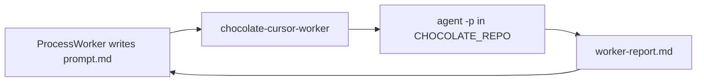

# Cursor worker for playbook runs

A playbook claim stays refused until `.chocolate/config.yaml` lists a command for `workers.default` and `workers.implement`. The engine writes `prompt.md`, appends that path as the last argument, and reads `worker-report.md` for `STATUS: done|partial|blocked`. This slice ships the program those two lists launch, and documents the lines to paste. It does not fill the config, and it does not call Cursor during `pnpm test`.

The host is the Cursor CLI already installed as `agent`. Both roles use the same program. The engine already sends a different prompt per role.

## Decisions

- The worker stays an argv list. `ProcessWorker`, the phases, and the gates stay as they are.
- `.chocolate/config.yaml` and the stamp template gain no `workers` block.
- The program runs `agent` with no shell. Headless flags are `-p`, `--force`, `--trust`, `--sandbox disabled`, and `--output-format text`. They are placed after any flags from the command list, so a pasted `--model` cannot drop them.
- No model is pinned. No timeout is set. A running agent holds the walk until it exits.
- `partial` is written only by the agent. The program synthesizes `done` or `blocked`.
- A missing `agent` binary is `blocked` for that role. The implement-to-default fallback still happens only when the implement command’s own first binary cannot be spawned.
- Tests substitute `CHOCOLATE_AGENT_BIN` or an injected spawn. `pnpm test` does not start Cursor and does not use the network.

## Architecture

`pnpm --dir <factory> exec` starts the script with the factory checkout as its working directory, even when `ProcessWorker` set the child cwd to the target repo. The script therefore does not trust `process.cwd()` for the repo. It resolves `CHOCOLATE_REPO` and uses that as the agent’s cwd and `--workspace`.



## Components

| Unit | What it does | Depends on |
| --- | --- | --- |
| `runCursorWorker` | Resolves the repo and the prompt, deletes a stale report, spawns `agent`, then leaves a valid `STATUS` line in place. | An injected spawn function |
| `bin/chocolate-cursor-worker.ts` | Parses `process.argv`, calls `runCursorWorker`, and exits with the returned code. The production spawn uses `child_process.spawn` with ignored stdio and no shell. | `runCursorWorker` |

`src/engine/playbook/cursorWorker.ts` exports `runCursorWorker`. The bin does not contain the rules.

```typescript
export interface CursorWorkerSpawn {
  (input: { bin: string; args: string[]; cwd: string; env: NodeJS.ProcessEnv }): Promise<{
    code: number | null;
    error: NodeJS.ErrnoException | null;
  }>;
}

export function runCursorWorker(input: {
  argv: string[];
  env: NodeJS.ProcessEnv;
  cwd: string;
  spawnAgent: CursorWorkerSpawn;
}): Promise<number>;
```

`argv` is everything after the script name. The last entry is the prompt path. Earlier entries are forwarded to `agent` as flags. The returned number is the wrapper’s exit code: `0` when `worker-report.md` has a valid status line, `1` when that file cannot be written or the prompt path is missing.

## Data flow

1. Resolve `CHOCOLATE_REPO` against `cwd` when it is set and non-empty. Otherwise the repo is `cwd`. A relative value resolves against `cwd`. An absolute value is used as given.
2. The last `argv` entry is the prompt path. Every earlier entry is forwarded unchanged, and those entries are flags only. Resolve a relative prompt path against `cwd`, not against the repo: `ProcessWorker` already joins the prompt path onto the repo root. An absolute prompt path is used as given. A missing last entry prints `usage: chocolate-cursor-worker <prompt-file>` to stderr and returns `1` without spawning.
3. The report path is `worker-report.md` in `CHOCOLATE_RUN_DIR` when that variable is set and non-empty. A relative run directory resolves against `cwd`. Otherwise the report directory is the prompt file’s directory.
4. Read the prompt file as UTF-8. When the read fails, replace `worker-report.md` with `STATUS: blocked` and the note `prompt unreadable: <message>`, spawn nothing, and return `0`.
5. Delete `worker-report.md` when it already exists, so an earlier dispatch in the same attempt directory cannot satisfy this one.
6. Spawn `CHOCOLATE_AGENT_BIN` when that variable is set and non-empty, otherwise `agent`. The child cwd is the resolved repo. The child inherits `env`. Stdout and stderr are ignored. The argument list is:

```text
[forwarded flags] -p --force --trust --sandbox disabled --output-format text --workspace <resolved repo> <prompt text>
```

7. After the child exits, if `worker-report.md` contains a line `STATUS: done`, `STATUS: partial`, or `STATUS: blocked`, leave the file unchanged and return `0`.
8. Otherwise replace the file and return `0`:
   - Child exit code `0` writes `STATUS: done` and no note.
   - Any other code, a null code, or a spawn error writes `STATUS: blocked` and one note line.

The note for a numeric exit is `agent exited <code>`. The note for a spawn error is `agent spawn failed: <message>`. The note for a null code with no spawn error is `agent exited null`.

## Error handling

A failure to delete the stale report, to read a prompt that then cannot be recorded, or to write `worker-report.md` rejects. The bin prints that error to stderr and exits `1`. `ProcessWorker` then sees no status line and records `blocked` with its existing missing-report note.

The program does not kill the child. Closing the factory stops the walk only when the process is stopped with the child.

An agent that writes a valid status line keeps that line, including `partial` and including `blocked` after a non-zero exit. The program does not merge its own note into a report the agent wrote.

## README

Under Playbook engine, state that `agent login` is required once on the machine, that both command lists are pasted by the operator, and that a playbook claim is refused until both are non-empty. The factory appends the prompt path and does not merge.

The sample uses an absolute factory checkout because the command runs against the target repo:

```yaml
workers:
  default:
    command:
      - pnpm
      - --dir
      - /absolute/path/to/chocolate-factory
      - exec
      - tsx
      - bin/chocolate-cursor-worker.ts
  implement:
    command:
      - pnpm
      - --dir
      - /absolute/path/to/chocolate-factory
      - exec
      - tsx
      - bin/chocolate-cursor-worker.ts
```

A model flag, when wanted, is an extra entry on that list, after the script path. The sample does not include one.

## Testing

Tests live in `tests/engine/playbook/cursorWorker.test.ts`. They call `runCursorWorker` with a fake spawn except for the one bin launch.

- Exit 0 and no report writes exactly `STATUS: done\n`.
- A report the fake spawn writes, containing `STATUS: partial`, is unchanged after the call.
- Exit 1 and no report writes `STATUS: blocked\nagent exited 1\n`.
- A spawn `ENOENT` writes `STATUS: blocked\nagent spawn failed: <message>\n` and the function returns `0`.
- Forwarded flags appear before `-p --force --trust --sandbox disabled --output-format text`. `--workspace` is the resolved `CHOCOLATE_REPO`. The last argument is the prompt text.
- A relative `CHOCOLATE_REPO` resolves against `cwd`, and the child cwd is that directory.
- A missing prompt path returns `1` and does not spawn.
- An unreadable prompt writes `blocked`, does not spawn, and returns `0`.
- A `worker-report.md` left from a previous call is deleted before spawn. The new result is the only status.
- One test launches `tsx bin/chocolate-cursor-worker.ts` with `CHOCOLATE_AGENT_BIN` set to a fake executable and asserts the same `STATUS: done` report.

No phase test, gate test, or config file changes.

## Out of scope

- Writing `workers` into `.chocolate/config.yaml` or the stamp template.
- A timeout, a pinned model, or a change to `ProcessWorker`.
- Parsing agent stdout into artifacts.
- A live `agent` run in `pnpm test` or in CI.
- Claude Code, Codex, and the Cursor SDK.
